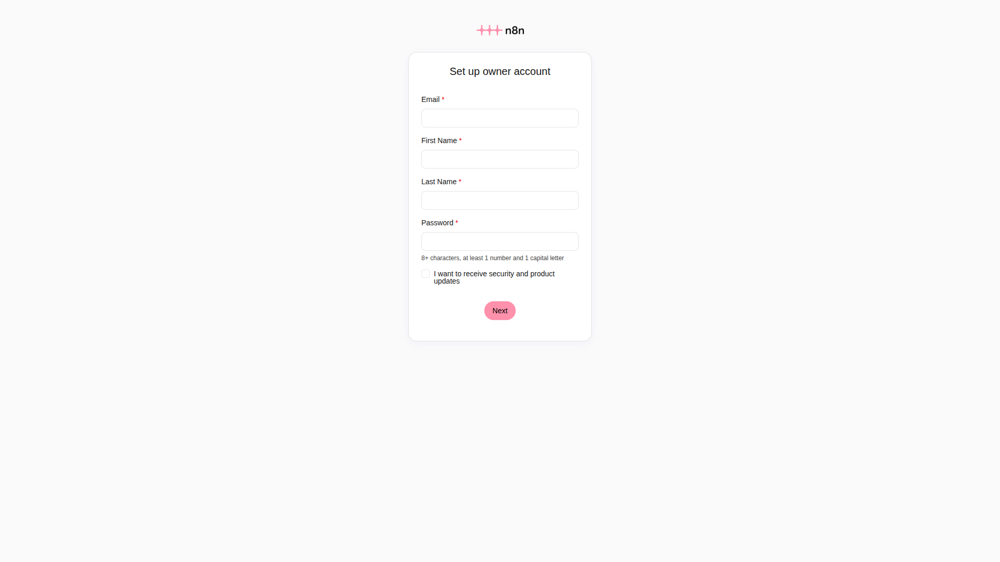
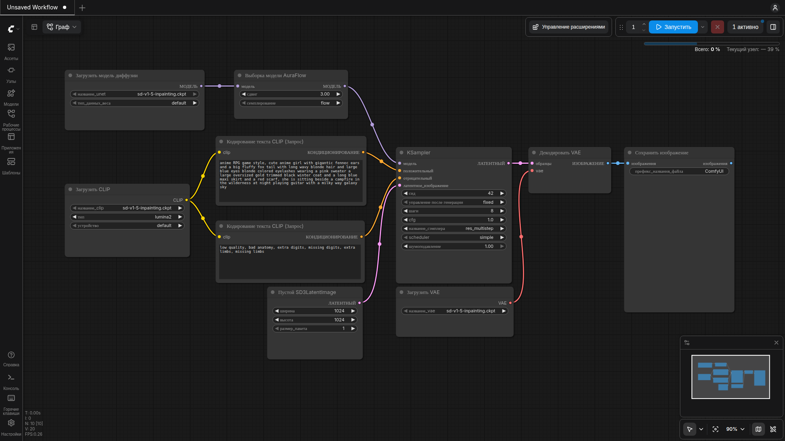

# 🚀 DevOps / MLOps Portfolio — Алексей (sokstr)

**Middle DevOps / MLOps Engineer** · Production Home-Lab (18+ сервисов) · Linux · Docker · Proxmox · Kubernetes (k3s) · Helm · Terraform · Ansible · Prometheus/Grafana · AI Infra (Ollama/RAG)

> Практический репозиторий-портфолио: эксплуатация инфраструктуры, автоматизация, мониторинг, CI/CD и локальный AI/MLOps-стек.  
> **GitHub:** https://github.com/358630ccok-sys/sokstr · **Резюме:** [resume.md](resume.md) · **Портфолио для интервью:** [docs/PORTFOLIO_INTERVIEW.md](docs/PORTFOLIO_INTERVIEW.md)

---

## ⚡ Для рекрутера (за 30 секунд)

- **Роль:** Middle DevOps / MLOps Engineer (remote/hybrid), опыт эксплуатации в enterprise (Lenta) + собственная production-платформа.
- **Инфраструктура:** Proxmox VE, **18+ сервисов** (LXC/VM/Docker), Nginx, VPN, бэкапы, документация.
- **Kubernetes/IaC (hands-on lab):** развернул **k3s** на Proxmox (CT200), работал с **kubectl, Helm, Terraform, Ansible** (деплой приложений, Helm chart/CronJob, IaC, roles/templates). → [docs/INFRA_LAB_STATUS.md](docs/INFRA_LAB_STATUS.md), [docs/K8S_TERRAFORM_PRACTICE.md](docs/K8S_TERRAFORM_PRACTICE.md)
- **Наблюдаемость:** Prometheus + Grafana (дашборды, в т.ч. AI-мониторинг), healthchecks, анализ логов.
- **Автоматизация:** n8n, Bash/Python, Telegram-боты, GitLab CI/CD.
- **AI/MLOps:** Ollama (GPU inference), RAG (SQLite + embeddings), Dify, Qdrant, ComfyUI.
- **Что внутри репо:** код бота (`job_bot/`), резюме, архитектура, runbook/доки, скриншоты, материалы для откликов.

---

## 🏗️ Архитектура платформы (high-level)

```text
                         ┌───────────────────────────────┐
                         │      Planning / AI Agents     │
                         │  постановка задач, анализ, docs│
                         └───────────────┬───────────────┘
                                         │
                                         ▼
                    ┌────────────────────────────────────────┐
                    │        Automation & Operations         │
                    │   n8n · scripts · bots · CI/CD         │
                    └───────────────────┬────────────────────┘
                                        │ SSH / API / Docker / K8s
                                        ▼
┌──────────────────────────────── Proxmox VE (18+ services) ──────────────────────────┐
│  LXC / VM / Docker                                                                  │
│  • Ollama (LLM/GPU)      • Prometheus/Grafana (monitoring)   • n8n (automation)    │
│  • Dify / Qdrant (RAG)   • GitLab/Runner (CI/CD)             • ComfyUI (AI media)  │
│  • Nginx, VPN, Vaultwarden, Nextcloud, LiteLLM и др.                                │
│                                                                                     │
│  DevOps Lab (CT200, 192.168.10.240): k3s · kubectl · Helm · Terraform · Ansible    │
└───────────────┬───────────────────────────────┬───────────────────────────┬─────────┘
                ▼                               ▼                           ▼
         Telegram-интеграции              RAG / Knowledge Base           CI/CD & Runbooks
          (job_bot, alerts)           (Obsidian, embeddings, Dify)      (GitLab, docs, ops)
```

Подробнее: [architecture.md](architecture.md)

---

## 🧰 Ключевой стек

| Область | Технологии |
|---|---|
| **Linux / Ops** | Linux, Bash, systemd, journalctl, SSH, диагностика инцидентов, эксплуатация в SLA |
| **Виртуализация / Контейнеры** | Proxmox VE, LXC/VM, Docker, Docker Compose |
| **Kubernetes / IaC** | k3s, kubectl, Helm, Terraform, Ansible (hands-on lab на Proxmox) |
| **CI/CD** | Git, GitLab, GitLab Runner |
| **Мониторинг** | Prometheus, Grafana, healthchecks, анализ логов |
| **Автоматизация** | Python, Bash, n8n, Telegram Bot API |
| **AI / MLOps** | Ollama (ROCm/GPU), RAG (SQLite + nomic-embed-text), Dify, Qdrant, ComfyUI |
| **Сеть / Доступ** | Nginx (reverse proxy), VPN (WireGuard/AmneziaWG), основы DNS/маршрутизации |
| **Практики** | `.env`/секреты вне git, бэкапы, логирование, документирование, воспроизводимость |

---

## 🧪 Что реализовано (практика)

### 1) Production Home-Lab (эксплуатация)
- Спроектировал и сопровождаю платформу **18+ сервисов** на Proxmox VE.
- Настроил наблюдаемость (Prometheus/Grafana), автоматизацию (n8n/скрипты/боты) и поддержку AI-сервисов.
- Веду эксплуатационные практики: диагностика, контроль состояния, бэкапы, документация.

### 2) Kubernetes / Helm / Terraform / Ansible Lab
- **CT200 `k8s-lab`**: k3s (Ready), kubectl, Helm v3, Terraform v1.9, Ansible.
- Отработано: Deployment/Service/Ingress, Helm chart, Terraform (local + Kubernetes provider), Ansible role/Jinja, деплой CronJob в k3s.
- Детали: [docs/INFRA_LAB_STATUS.md](docs/INFRA_LAB_STATUS.md) · [docs/K8S_TERRAFORM_PRACTICE.md](docs/K8S_TERRAFORM_PRACTICE.md)

### 3) Job Hunter Bot (`job_bot/`)
Автоматизация поиска вакансий и доставки отчётов в Telegram.
- **Источники:** hh.ru API, LinkedIn (парсинг guest/RSS fallback)
- **Стек:** Python, aiogram, requests, BeautifulSoup, feedparser, python-dotenv
- **Запуск:** локально или в Docker, конфигурация через `.env` (секреты не хранятся в git)

**Быстрый старт:**
```bash
cd job_bot
cp .env.example .env
# заполнить переменные окружения
python3 -m venv .venv && source .venv/bin/activate
pip install -r requirements.txt
python job_hunter.py
```

**Docker:**
```bash
cd job_bot
docker build -t job-bot .
docker run --rm --env-file .env job-bot
```

### 4) AI/MLOps контур
- **LLM inference:** Ollama (GPU/ROCm), эксплуатация локальных моделей
- **RAG:** индексирование базы знаний (SQLite + embeddings), поиск контекста для задач/документации
- **Платформы:** Dify, Qdrant, ComfyUI (генеративные пайплайны)

---

## 📸 Скриншоты и артефакты

| Область | Пример | Что показывает / результат |
|---|---|---|
| **Мониторинг** |  | Дашборд Grafana + метрики Prometheus: контроль состояния сервисов и AI-инфраструктуры, быстрая диагностика |
| **Инфраструктура** |  | Proxmox VE: управление LXC/VM и ресурсами платформы (18+ сервисов) в едином контуре |
| **Автоматизация** |  | n8n workflow/healthchecks: автоматизация проверок и интеграций, меньше ручных операций |
| **AI/MLOps** |  | ComfyUI-пайплайн: практическая AI-инфраструктура для генерации/обработки контента |

Дополнительно: `docs/screenshots/terminal/` (артефакты команд/состояния), другие каталоги — заготовки для новых скриншотов (`telegram`, `ci-cd`).

> Пути к изображениям проверены (`docs/screenshots/{grafana,proxmox,n8n,ai}/*.png`) — в README GitHub они должны отображаться корректно.

---

## 🤖 Как я работаю с AI-агентами

Практический workflow (в терминале/IDE), ориентированный на воспроизводимость и проверку результата:

1. **Постановка задачи:** формулирую цель, ограничения, критерии готовности (что должно работать/где проверить).
2. **Контекст и правила:** фиксирую контекст проекта и ограничения (структура репозитория, соглашения, безопасность, запрет на секреты в git). При работе с агентами использую проектные инструкции/правила (например, `AGENTS.md`, шаблоны задач).
3. **Декомпозиция:** разбиваю задачу на небольшие шаги (диагностика → изменение → проверка), чтобы быстро находить ошибки.
4. **Выполнение с инструментами:** агент помогает читать код/логи, искать по проекту, вносить правки, запускать команды, автоматизировать рутину (скрипты, n8n, боты).
5. **Проверка результата (обязательно):**
   - логи и код возврата команд (`journalctl`, логи контейнеров, вывод CLI);
   - сверка с источником/ожидаемым поведением (API, UI, метрики, файлы);
   - мониторинг/healthchecks (Prometheus/Grafana) и точечные smoke-проверки.
6. **Фиксация:** коммит изменений, обновление документации/runbook, выводы по инциденту или улучшению.

> Принцип: агент ускоряет выполнение, но решения по доступам, данным, безопасности и финальной валидации принимает человек.

---

## 📂 Навигация по репозиторию

- [resume.md](resume.md) — актуальное резюме (Middle DevOps / MLOps)
- [architecture.md](architecture.md) — описание архитектуры и компонентов
- [docs/INFRA_LAB_STATUS.md](docs/INFRA_LAB_STATUS.md) — статус k3s/Helm/Terraform/Ansible lab
- [docs/K8S_TERRAFORM_PRACTICE.md](docs/K8S_TERRAFORM_PRACTICE.md) — практические упражнения и заметки
- [docs/PORTFOLIO_INTERVIEW.md](docs/PORTFOLIO_INTERVIEW.md) — как презентовать опыт на интервью
- [docs/COVER_LETTER_TEMPLATE.md](docs/COVER_LETTER_TEMPLATE.md) — шаблоны сопроводительных писем
- [docs/runbooks/postgres-backup-restore.md](docs/runbooks/postgres-backup-restore.md) — PostgreSQL: бэкапы, роли/права, restore и проверка восстановления
- [docs/runbooks/postgres-backup-restore-practice.md](docs/runbooks/postgres-backup-restore-practice.md) — практический сценарий backup → restore → проверка (safe demo)
- [docs/runbooks/postgres-restore-verification-template.md](docs/runbooks/postgres-restore-verification-template.md) — шаблон фиксации результата restore-проверки (PASS/FAIL)
- [docs/runbooks/incident-service-outage-home-lab.md](docs/runbooks/incident-service-outage-home-lab.md) — разбор инцидента: диагностика, root cause, профилактика
- [docs/screenshots/telegram/job_bot_demo.txt](docs/screenshots/telegram/job_bot_demo.txt) — пример вывода Job Hunter (`--demo`)
- [docs/screenshots/telegram/README.md](docs/screenshots/telegram/README.md) — примечания по demo/артефактам Telegram-бота
- [docs/](docs/) — дополнительные материалы (LinkedIn, HH/отклики, планы, скриншоты)

---

## 🎯 Чем могу быть полезен команде
- Эксплуатация и диагностика Linux/Docker/Proxmox-инфраструктуры
- Настройка мониторинга, алертов и эксплуатационных процессов
- Автоматизация рутин (скрипты, боты, n8n, интеграции)
- Поддержка CI/CD и воспроизводимых окружений
- Развёртывание и сопровождение AI/LLM-сервисов (Ollama, RAG-контур)
- Развитие IaC/Kubernetes-практик (k3s, Helm, Terraform, Ansible — hands-on)

---

## 👤 Контакты
- **Город:** Воронеж, РФ (удалёнка / гибрид)
- **Email:** 358630cok@mail.ru
- **Телефон:** +7 (960) 107-19-92
- **Telegram:** [@sokstr](https://t.me/sokstr)
- **LinkedIn:** [Алексей Саковский](https://www.linkedin.com/in/%D0%B0%D0%BB%D0%B5%D0%BA%D1%81%D0%B5%D0%B9-%D1%81%D0%B0%D0%BA%D0%BE%D0%B2%D1%81%D0%BA%D0%B8%D0%B9-34224a185/)
- **HH.ru:** [Резюме на HH](https://voronezh.hh.ru/resume/31ec25d8ff11556f6f0039ed1f376f70414174)
- **GitHub:** https://github.com/358630ccok-sys/sokstr
- **Подробное резюме:** [resume.md](resume.md)
