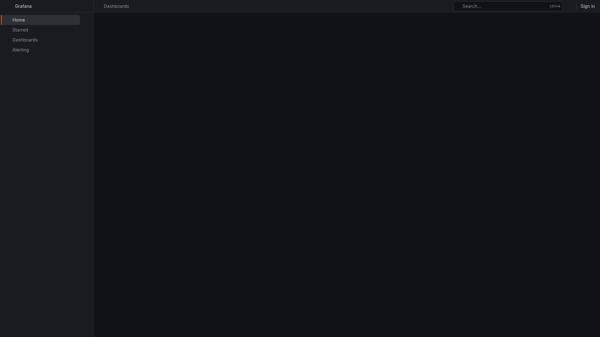
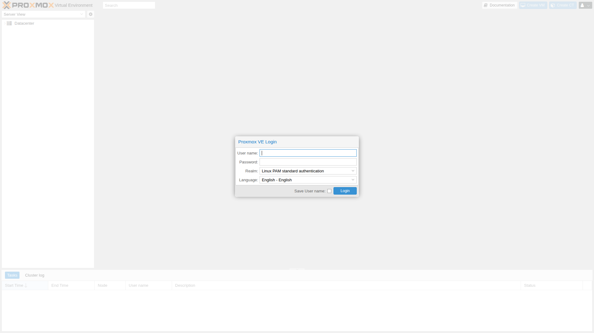

# 🚀 sokstr-mlops — DevOps / MLOps Portfolio

**Production home-lab & AI infrastructure**: Proxmox VE · Docker/LXC · Prometheus/Grafana · n8n · GitLab CI · Ollama · RAG · Telegram automation

> Репозиторий-портфолио Middle DevOps / MLOps-инженера (Алексей, `sokstr`): эксплуатация инфраструктуры, автоматизация, мониторинг и локальный AI-стек.

---

## 📌 Обзор
Этот проект объединяет **инфраструктурную платформу** и **практические DevOps/MLOps артефакты**:
- 🏗️ Эксплуатация кластера **Proxmox VE** (18+ сервисов, LXC/VM, Docker)
- 📊 Наблюдаемость: **Prometheus + Grafana** (дашборды, healthchecks)
- ⚙️ Автоматизация: **n8n**, Bash/Python скрипты, Telegram-интеграции
- 🧠 AI/MLOps: **Ollama** (GPU inference), **RAG** (SQLite + embeddings), **Dify/Qdrant**, **ComfyUI**
- 🤖 Боты: **Job Hunter** (hh.ru/LinkedIn), VPN bot, уведомления

---

## 🏗️ Архитектура (high-level)

```text
                         ┌───────────────────────────────┐
                         │   Cloud Planner (OpenCode)    │
                         │  планирование / анализ / отчёты│
                         └───────────────┬───────────────┘
                                         │ задачи
                                         ▼
                    ┌────────────────────────────────────────┐
                    │        Local Executors (on host)       │
                    │   local-reader  ·  local-coder  · bash │
                    └───────────────────┬────────────────────┘
                                        │ SSH / API / Docker
                                        ▼
┌──────────────────────────────── Proxmox VE Cluster ─────────────────────────────────┐
│  LXC / VM / Docker services (18+)                                                  │
│                                                                                    │
│  CT103  Ollama        192.168.10.103      LLM inference (GPU/ROCm)                 │
│  CT105  Prometheus    192.168.10.105:9090 Metrics collection                       │
│  CT106  Grafana       192.168.10.106:3000 Dashboards (ai-monitoring-2026)         │
│  CT134  n8n           192.168.10.134:5678 Workflow automation / healthchecks        │
│  VM112  Dify          192.168.10.112      AI apps / RAG platform                    │
│  Docker ComfyUI       192.168.10.100:8188 Image generation (SDXL/IPAdapter)         │
│  + GitLab/Runner, Nginx, Vaultwarden, Qdrant, LiteLLM, Nextcloud, VPN, etc.       │
└───────────────┬───────────────────────────────┬───────────────────────────┬────────┘
                │                               │                           │
                ▼                               ▼                           ▼
         Telegram Bots/API                 RAG / Knowledge            CI/CD & Ops
      (job_bot, уведомления)        (SQLite + embeddings, Dify)    (GitLab, scripts, logs)
```

---

## 🧰 Стек и сервисы

| Категория | Технологии / сервисы | Назначение |
|---|---|---|
| **Виртуализация / хостинг** | Proxmox VE, LXC, VM, Docker | Запуск и изоляция сервисов, управление ресурсами |
| **OS / администрирование** | Linux, Bash, systemd, SSH | Эксплуатация, диагностика, обслуживание |
| **Мониторинг** | Prometheus, Grafana | Метрики, дашборды, контроль состояния (в т.ч. AI) |
| **Автоматизация** | n8n, Python, Bash, cron/расписания | Оркестрация процессов, интеграции, healthchecks |
| **CI/CD / SCM** | Git, GitLab, GitLab Runner | Контроль версий, пайплайны сборки/деплоя |
| **AI / MLOps** | Ollama, ROCm/GPU, Dify, Qdrant, ComfyUI | Локальный inference, AI-приложения, генерация контента |
| **RAG / данные** | SQLite, nomic-embed-text (Ollama), Obsidian knowledge base | Индексация и поиск по знаниям (309 чанков) |
| **Сеть / доступ** | Nginx, VPN (AmneziaWG/WireGuard), Telegram Bot API | Reverse proxy, удалённый доступ, уведомления/боты |
| **Утилиты / сервисы** | Vaultwarden, Nextcloud, LiteLLM, Code Server и др. | Инфраструктурные и пользовательские сервисы |

---

## 🤖 Автоматизация и боты

### Job Hunter Bot (`job_bot/`)
- **Назначение:** автоматический поиск вакансий и отправка отчёта в Telegram
- **Источники:** hh.ru API, LinkedIn (парсинг guest endpoint / RSS fallback)
- **Стек:** Python, `aiogram`, `requests`, `BeautifulSoup`, `feedparser`, `python-dotenv`
- **Деплой:** Docker (`job_bot/Dockerfile`), конфигурация через `.env` (без секретов в git)
- **Режим:** запуск по расписанию (ежедневная автоматизация) + ручной запуск

**Ключевые файлы:**
- `job_bot/job_hunter.py` — логика сбора, форматирования и отправки вакансий
- `job_bot/Dockerfile` — контейнеризация
- `job_bot/requirements.txt` — зависимости
- `job_bot/.env.example` — шаблон переменных окружения

### Другие интеграции
- **VPN bot** — управление VPN-сценариями (AmneziaWG/WireGuard)
- **Obsidian bot** — сервисные сценарии вокруг заметок/доступа
- **Telegram notifications** — отправка отчётов и уведомлений о состоянии/задачах

---

## 🧠 AI/MLOps контур
- **LLM Inference:** Ollama (в т.ч. `qwen2.5-coder:3b`, GPU/ROCm), эксплуатация и контроль ресурсов
- **RAG:** SQLite + `nomic-embed-text` (через Ollama), индекс заметок Obsidian (**309 чанков**), поиск релевантного контекста
- **AI-платформы/инструменты:** Dify, Qdrant, ComfyUI (SDXL, IPAdapter FaceID пайплайны)
- **Career Agent:** n8n + Ollama для поиска/оценки вакансий и подготовки материалов с доставкой в Telegram
- **Подход:** локальный inference, автоматизация пайплайнов, наблюдаемость за AI-сервисами

---

## 📊 Мониторинг и эксплуатация
- **Prometheus** — сбор метрик инфраструктуры и сервисов
- **Grafana** — визуализация, дашборды (включая `ai-monitoring-2026`)
- **n8n healthchecks/workflows** — проверки доступности и автоматические сценарии реагирования/уведомлений
- **Эксплуатационные практики:** анализ логов, диагностика инцидентов, бэкапы, документирование изменений и конфигураций
- **Фокус:** прозрачность состояния, воспроизводимость, быстрое восстановление

---

## 🚀 Деплой / запуск

### Job Hunter Bot (локально или в Docker)

1. Подготовить переменные окружения:
```bash
cd job_bot
cp .env.example .env
# заполнить TG_TOKEN / HH_TOKEN (опционально) / TELEGRAM_CHAT_ID
```

2. Установить зависимости (локальный запуск):
```bash
python3 -m venv .venv
source .venv/bin/activate
pip install -r requirements.txt
python job_hunter.py
```

3. Запуск в Docker:
```bash
cd job_bot
docker build -t job-bot .
docker run --rm --env-file .env job-bot
```

> ⚠️ Не коммитьте `.env`, токены и другие секреты. Используйте `.env.example` как шаблон.

### Общие принципы деплоя сервисов в платформе
- **Proxmox LXC/VM** — для системных сервисов и изолированных окружений
- **Docker / Docker Compose** — для приложений и интеграций (боты, утилиты, AI-компоненты)
- **Nginx reverse proxy** — маршрутизация и доступ к сервисам
- **GitLab + Runner** — CI/CD автоматизация (сборка/проверки/деплой)
- **Prometheus/Grafana** — контроль состояния после деплоя

---

## 📸 Портфолио: скриншоты (живые артефакты)

### 📊 Мониторинг (Grafana)

*Наблюдаемость: Prometheus + Grafana, контроль состояния 18+ сервисов*

### 🏗️ Инфраструктура (Proxmox VE)

*Production home-lab: Proxmox VE, LXC/VM, Docker — 18+ сервисов*

### ⚙️ Автоматизация (n8n)

*Автоматизация процессов: n8n workflow, healthchecks, интеграции*

### 🎨 AI/MLOps (ComfyUI)

*MLOps: ComfyUI, SDXL, IPAdapter FaceID — генерация контента*

### 📸 Дополнительные артефакты (планируются)
| Артефакт | Что демонстрирует | Где хранить |
|---|---|---|
| Скриншоты n8n workflows (детально) | Автоматизация, интеграции, healthchecks | `docs/screenshots/n8n/` |
| Скриншоты ComfyUI / AI пайплайнов | Практика AI/MLOps инфраструктуры | `docs/screenshots/ai/` |
| Схема архитектуры (network/services) | Понимание инфраструктуры и зависимостей | `docs/architecture/` |
| Примеры логов/инцидент-заметок (обезличенно) | Диагностика, эксплуатация, runbooks | `docs/runbooks/` |
| Фрагменты CI/CD конфигов и деплоя | Автоматизация поставки | `docs/ci-cd/` или репозитории сервисов |

> Рекомендация: добавлять скриншоты без секретов/внутренних токенов, с краткими подписями «что видно и какую проблему решает».

---

## 🎯 Фокус
- **DevOps:** эксплуатация Linux-инфраструктуры, виртуализация, контейнеры, сеть, reverse proxy
- **MLOps / AI Infra:** локальный inference, RAG, поддержка AI-сервисов и пайплайнов
- **Автоматизация:** боты, workflow-оркестрация, CI/CD, снижение ручной рутины
- **Надёжность:** мониторинг, диагностика, документирование, воспроизводимость

---

## 👤 Автор
- **Алексей (sokstr)**
- **GitHub:** https://github.com/sokstr/sokstr-mlops
- **Роль:** Middle DevOps / MLOps Engineer (remote-friendly)
